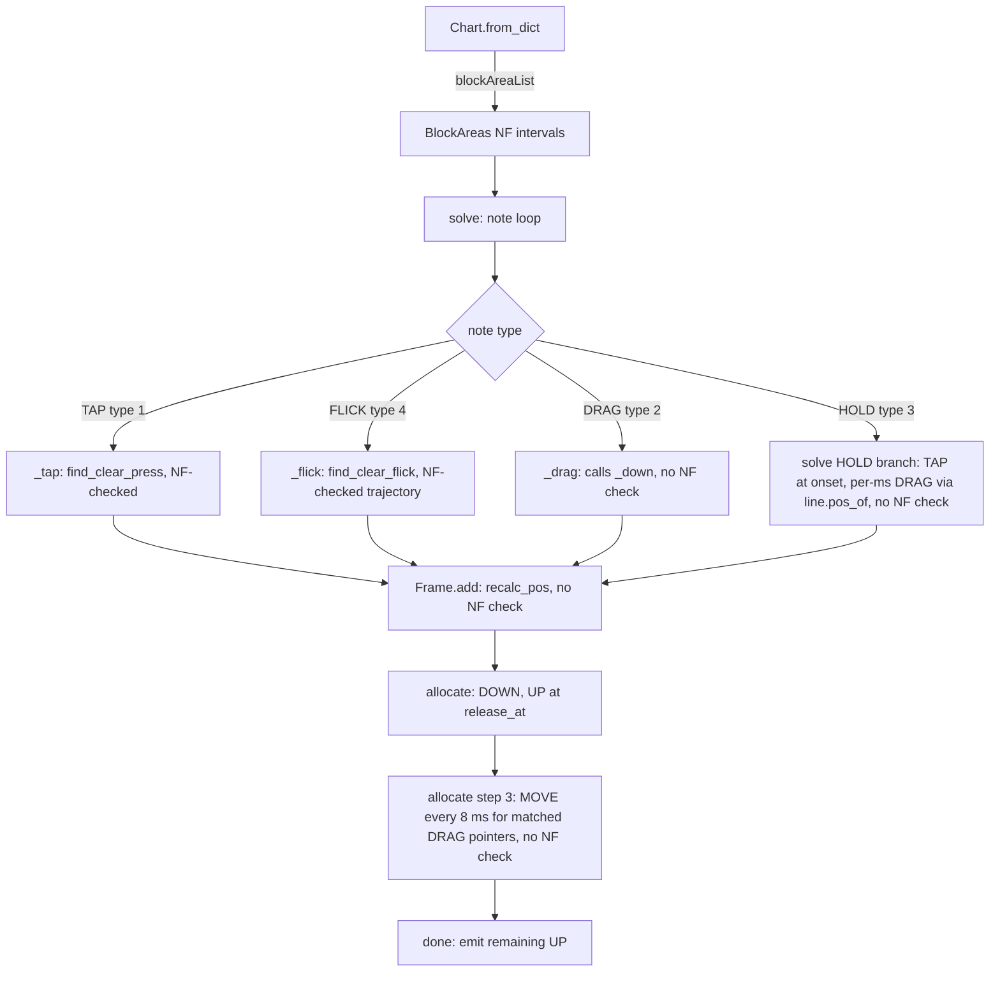

# NF Execution Path (Algo3, DesultorySignals AT)

Scope: `algo/algo3.py` as it exists, unmodified. Node labels name functions. "NF-checked" means the function calls `BlockAreas.search_point` or `blocked` before emitting a position.

## Path details

| Stage | Function | NF check | Evidence |
|---|---|---|---|
| Chart load | `Chart.from_dict` | n/a | builds `BlockAreas(d.get('blockAreaList', []))` |
| Interval test | `BlockAreas.blocked` / `BlockArea.contains` | the check itself | `BUCKET=0.5 s`, `USE_SUBTRACT=False`, `margin_at(t)=30` |
| TAP placement | `_tap` via `find_clear_press` | yes, margin per `margin_at` | sets `note.pos=found` before `_down` |
| FLICK placement | `_flick` via `find_clear_flick` / `flick_path_clear` | yes, whole path | MOVE every 5 ms, `note.pos` = endpoint |
| Position clamp | `Frame.add` → `utils.recalc_pos` | no | moves off-screen points to the screen edge; not NF-aware |
| HOLD onset | `solve` HOLD branch | no | emits TAP at onset without a placement search |
| HOLD body | `solve` HOLD branch via `judge_line.pos_of` | no | per-ms DRAG, no judge-line constraint |
| DRAG | `_drag` → `_down` | no | "no NF check" in source |
| Continuation | `allocate` step 3 | no | MOVE every `drag_step=8` ms for matched DRAG pointers |
| Release | `_down` inserts UP at `_release_at` | no | UP for previous note emitted before the next DOWN |

## Execution-path verification

Attribution by `origin_method` (wrapper verified identical to the unmodified capture, 17,308 events):

| origin | action | total | violations m0 | violations m30 |
|---|---|---|---|---|
| `_tap` (`_down:type1`) | DOWN | 1260 | 0 | 0 |
| `_tap` (`_down:type1`) | UP | 1207 | 1 | 3 |
| `_flick` | DOWN / MOVE / UP | 112 / 2240 / 95 | 0 / 0 / 0 | 0 / 0 / 0 |
| `_down:type2` (DRAG/HOLD onset) | DOWN | 220 | 14 | 14 |
| `_down:type2` (DRAG/HOLD release) | UP | 176 | 11 | 11 |
| `allocate:drag_continuation_or_release` | MOVE | 11884 | 867 | 1229 |
| `allocate:drag_continuation_or_release` | UP | 110 | 3 | 4 |
| `done` | UP | 4 | 0 | 0 |

Source-based reading: every violating event originates from a path that performs no NF check (`_drag`, HOLD branch, `allocate` step 3, or UP for these pointers). The two NF-checked paths (`_tap`, `_flick`) produce no violations for DOWN, MOVE or UP except one TAP-origin UP (82763 ms, pointer 1000), which closes a HOLD and is attributed to `_down:type1` only by the note type recorded at `_down`.

## Status
- Confirmed by data: origin attribution, counts above.
- Confirmed by source: which paths call an NF check.
- Not confirmed: device behaviour; whether the in-game judge reports these positions as misses.
