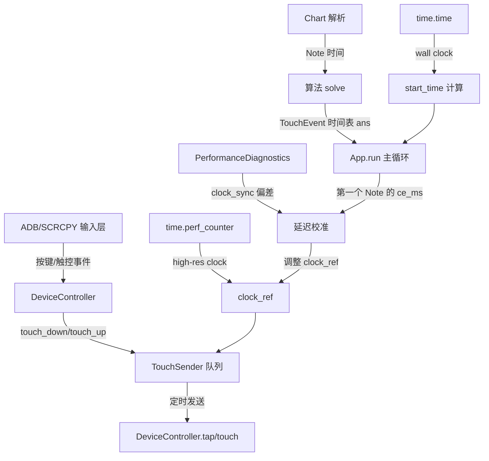

# PhiAPS 自动开始操作与延迟自动校准开发计划

## 一、当前实现情况

### 1.1 项目概况

| 项目 | 状态 |
|------|------|
| 当前稳定版本 | V 4.2 (`0935f59`) |
| Git 分支 | `main` (已同步 origin/main) |
| 工作区状态 | `main.py` 有未暂存修改；`plan.md`、`tools/trace_jumps.py` 为未跟踪文件 |
| 噪域避让开发 | 暂时冻结 |
| 998px 跳变 | 只读根因调查完成，未授权修改代码 |

### 1.2 自动开始操作 — 现状

**结论：当前程序完全没有自动开始操作能力。**

具体行为链（`main.py:App.run()`，第 445 行起）：

1. 用户必须**手动**在游戏内点击「开始」→ 选择曲目 → 选择难度 → 进入加载画面 → 点击「开始游戏」。
2. 进入游戏后，用户必须**手动暂停**。
3. UI 提示信息明确写道：`'请开始游戏，再暂停游戏，然后再点击上面的开始按钮'`（第 337 行）。
4. 用户点击 UI 上的「开始!」按钮后，程序才真正开始发送触控事件。

程序在 `run()` 方法中的行为：

```python
# 延时同步模式（sync_mode == 0），第 486 行
if self.sync_mode.get() == 0:
    ctl.tap(device_size[0] // 2, device_size[1] // 2)  # ← 立即模拟一次屏幕中央点击
    offset = self.delay.get()  # 默认 1.95 秒
    self.start_time = time.time() + offset  # ← 启动时间 = 当前 wall clock + 固定偏移
```

**关键发现：**
- `ctl.tap(device_size[0] // 2, device_size[1] // 2)` 是程序启动后立即执行的唯一一次触控操作，目的是什么尚不明确（可能是为了关闭某个弹窗，也可能是遗留代码）。
- `self.start_time = time.time() + offset` 使用固定的 `offset`（默认 1.95 秒）作为初始偏移，这个值是**用户手动调节的参数**，不是自动测量的。
- 没有任何代码检测游戏是否已启动、谱面是否已加载、或第一个 Note 何时出现。

### 1.3 延迟测量与校准 — 现状

#### 1.3.1 两种同步模式

| 模式 | sync_mode 值 | 校准方式 | 延迟来源 |
|------|-------------|---------|---------|
| 延时同步 | 0 | 用户手动设置 `delay` 参数（默认 1.95s） | 固定偏移 + 微调 |
| 手动同步 | 1 | 用户在第一个 Note 快落到判定线时手动点击「开始操作」按钮 | 基于第一个 Note 的理论时间反推 |

#### 1.3.2 时间系统架构

程序使用了**两套时钟**：

| 时钟 | Python API | 用途 |
|------|-----------|------|
| Wall Clock | `time.time()` | 计算 `now = round((time.time() - self.start_time) * 1000)`，代表"谱面内的毫秒数" |
| Performance Counter | `time.perf_counter_ns()` | 高精度调度计时，用于 `TouchSender._loop()` 中的 `time.sleep(wait)` |

时间参考点 `clock_ref`：

```python
clock_ref = {'start': 0.0}  # perf_counter 秒，表示"计划起点"
```

微调机制（第 508-515 行）：

```python
def incremented(event):
    self.start_time += 0.01
    clock_ref['start'] = time.perf_counter() - (time.time() - self.start_time)

def decremented(event):
    self.start_time -= 0.01
    clock_ref['start'] = time.perf_counter() - (time.time() - self.start_time)
```

这个机制的核心思想是：当用户调整 `self.start_time` 时，同步更新 `clock_ref['start']`，使得后续 `TouchSender._loop()` 中的 `wait = self.clock() + ms / 1000 - time.perf_counter()` 能够立即反映新的偏移。

#### 1.3.3 时钟同步记录

每 100ms 记录一次时钟偏差（第 562-566 行）：

```python
if now_ns - last_sync_ns >= 100_000_000:
    theoretical_ms = (now_ns / 1_000_000_000 - clock_ref['start']) * 1000
    _performance.record('clock_sync', run=run_id, theoretical_chart_ms=theoretical_ms,
                        wall_chart_ms=now, offset_ms=now - theoretical_ms)
```

这里 `offset_ms = now - theoretical_ms` 就是**墙钟时间与 perf_counter 推算时间之间的偏差**，可用于分析系统级漂移。

#### 1.3.4 性能诊断系统

`PerformanceDiagnostics` 类（第 35-97 行）记录以下指标：

| 指标类型 | 含义 |
|---------|------|
| `submit` | 主线程提交批次到队列的耗时和队列长度 |
| `consume` | 发送线程从队列取出的等待时间 |
| `send` | 实际发送触控包的耗时 |
| `late_send` | 晚发超过 100ms 的事件（丢弃 MOVE，只补发 DOWN/UP） |
| `sample: loop_interval` | 主循环迭代间隔 |
| `sample: update` | Tkinter `update()` 调用耗时 |
| `sample: refresh_timer` | 刷新计时器 UI 耗时 |
| `sample: submit_call` | 调用 `sender.submit()` 的耗时 |
| `summary` | 各 sample metric 的 P50/P95/P99 百分位 |
| `throughput` | 每秒提交/消费的批次数量 |

性能数据写入 `performance.log`（当前为空文件）。

#### 1.3.5 实际延迟数据（sender.log）

从 `sender.log` 的实际输出看：

- **初期延迟**：约 100-120ms 晚发（批次 7176ms ~ 7632ms）
- **后期延迟**：累积增长至 500-600ms 晚发（批次 146693ms ~ 146784ms）

这表明存在**系统性延迟漂移**——随着运行时间增长，`time.time()` 和 `time.perf_counter()` 之间的偏差逐渐增大，或者主循环的 `time.sleep(0.001)` + `self.update()` 开销累积导致提交滞后。

### 1.4 首次 Note 时间 — 现状

#### 1.4.1 理论时间的获取

谱面 JSON 中的每个 Note 都有 `time` 字段（单位：秒），通过 `chart.py` 的 `JudgeLine.seconds()` 转换为毫秒：

```python
# chart.py: JudgeLine.seconds()
def seconds(self, t: float) -> float:
    return t * 1.875 / self.bpm
```

算法生成的结果 `ans` 是一个 `dict[int, list[TouchEvent]]`，key 是毫秒时间戳。

#### 1.4.2 当前首次 Note 同步方式

**延时同步模式**：完全不依赖首次 Note 时间。`start_time` 由 `time.time() + offset` 决定，offset 是用户手动设置的固定值。

**手动同步模式**：依赖用户手动触发。当用户点击「开始操作」按钮时（第 610 行）：

```python
ce_ms, ces = next(ans_iter)  # 取出第一个 Note 的时间
self.start_time = time.time() - ce_ms / 1000 - 0.01  # 反推 start_time
```

这里 `ce_ms` 就是**第一个 Note 的理论击打时间**，程序用它来反推 `start_time`，使 `time.time() - self.start_time ≈ ce_ms / 1000`。

**关键发现：程序已经知道第一个 Note 的理论时间（`ce_ms`），但没有在延时同步模式下利用它进行自动校准。**

### 1.5 现有代码中可直接复用的模块

| 模块 | 位置 | 可复用性 |
|------|------|---------|
| `TouchSender` | `main.py:106` | ✅ 已有队列+定时发送机制，延迟校准可直接复用 |
| `PerformanceDiagnostics` | `main.py:35` | ✅ 已有完整的性能采样框架，可扩展延迟测量 |
| `clock_ref` 微调机制 | `main.py:476, 508-515` | ✅ 可自动计算补偿值 |
| `clock_sync` 记录 | `main.py:562-566` | ✅ 已有 `offset_ms` 偏差数据 |
| `LOOKAHEAD_MS = 120` | `main.py:30` | ✅ 提前提交窗口的常量 |
| `JudgeLine.seconds()` | `chart.py` | ✅ 将谱面时间转为毫秒 |
| `ans` 字典的第一个 key | `main.py:473` | ✅ 即第一个 Note 的理论时间 |
| `DeviceController.tap()` | `control.py` | ✅ 用于自动操作（需谨慎） |

### 1.6 当前缺失的功能

| 缺失功能 | 影响 | 优先级 |
|---------|------|--------|
| 游戏启动状态检测 | 无法自动判断何时开始发送触控 | P0 |
| 谱面加载完成检测 | 无法确定第一个 Note 何时出现 | P0 |
| 自动延迟测量 | 无法自动计算合理的 offset 值 | P1 |
| 首次 Note 时间自动关联 | 仍需用户手动点击第一个 Note 完成校准 | P1 |
| 延迟漂移自动补偿 | sender.log 显示延迟随时间累积增长 | P2 |

---

## 二、技术可行性分析

### 2.1 自动开始操作的可行性

#### 方案 A：ADB Shell 按键模拟（推荐）

**原理**：通过 ADB 发送 `KEYCODE_DPAD_CENTER`（确认键）或 `KEYCODE_SPACE`，模拟用户按下游戏开始按钮。

```bash
adb shell input keyevent KEYCODE_DPAD_CENTER
adb shell input keyevent KEYCODE_SPACE
```

**优点**：
- 不依赖 scrcpy，延迟更可控（ADB shell 命令直接在设备上执行）
- 不需要图像识别或屏幕状态检测
- 如果游戏在加载画面/选曲界面，按键可以直接触发"开始"

**缺点**：
- 需要知道游戏当前的 UI 状态（是否在加载画面？是否已选曲？）
- 不同版本的 Phigros 可能对按键响应不同

**延迟估计**：ADB shell 命令的典型延迟为 50-200ms，远低于触控发送链路的不确定性。

#### 方案 B：scrcpy 触控模拟

**原理**：通过现有的 `DeviceController.tap()` 在已知坐标点击"开始"按钮。

**优点**：
- 复用现有代码
- 如果知道按钮坐标，可以精确定位

**缺点**：
- 按钮坐标因设备分辨率而异
- 需要知道游戏当前处于哪个界面
- 延迟更高（经过 scrcpy 服务端 → TCP → ADB）

**延迟估计**：约 100-300ms（取决于 scrcpy 连接质量）。

#### 方案 C：图像识别（不推荐）

**原理**：通过 scrcpy 视频流帧分析，识别游戏是否已进入谱面。

**缺点**：
- 实现复杂度高
- 需要额外的图像处理库
- 实时性难以保证
- 超出本项目范围

### 2.2 自动延迟校准的可行性

**高度可行**。理由：

1. 程序已有 `PerformanceDiagnostics` 记录 `clock_sync` 偏差。
2. 程序已有 `clock_ref` 微调机制，可以自动调整时间偏移。
3. 程序已有 `sender.log` 记录实际晚发延迟。
4. 第一个 Note 的理论时间 `ce_ms` 已经可以从 `ans` 字典获取。

**核心思路**：

```
自动校准流程：
1. 程序启动 → 等待用户确认（或自动检测）
2. 获取第一个 Note 的理论时间 ce_ms
3. 记录程序启动时刻 t_start（perf_counter）
4. 当第一个 Note 实际被击打时，记录实际时刻 t_actual（perf_counter）
5. 计算偏差 delta = t_actual - (t_start + ce_ms/1000)
6. 自动调整 clock_ref['start'] += delta
```

但问题是：**如何知道第一个 Note "实际被击打"的时刻？** 程序本身不接收游戏的反馈。

**替代方案**：利用 `clock_sync` 记录的 `offset_ms` 偏差进行统计校准。

```
统计校准流程：
1. 运行 N 次（N >= 3），每次记录 offset_ms 序列
2. 计算 offset_ms 的中位数/均值
3. 将此值作为新的默认 offset
4. 下次运行时自动应用
```

### 2.3 首次 Note 时间同步的可行性

**可行，但需要解决一个关键问题：如何知道第一个 Note 何时"应该"被击打。**

当前程序的问题：
- 延时同步模式下，`start_time` 是 `time.time() + offset`，offset 是用户手动设置的。
- 手动同步模式下，用户手动触发，程序用 `ce_ms` 反推 `start_time`。

**改进方向**：

1. **半自动校准**：程序启动后，自动发送一次 ADB 按键（模拟用户点击开始），然后等待用户确认"已进入谱面"。确认后，程序记录当前 `time.time()` 和第一个 Note 的 `ce_ms`，自动计算 offset。

2. **全自动校准**（需要额外硬件/软件支持）：通过麦克风录制游戏音效，检测第一个 Note 的音效出现时刻，与理论时间对比。这超出了本项目范围。

3. **基于历史数据的自适应**：记录每次运行的 `offset_ms` 偏差，使用移动平均自动调整 offset。

---

## 三、模块依赖关系



**关键依赖**：

| 依赖 | 说明 |
|------|------|
| `DeviceController` | 所有触控/按键操作的底层实现 |
| `TouchSender` | 定时发送引擎，依赖 `clock_ref` |
| `Chart` + 算法 | 提供 `ans` 字典（时间→事件映射） |
| `PerformanceDiagnostics` | 提供延迟测量数据 |
| ADB/scrcpy | 外部依赖，需要设备和 adb 可用 |

---

## 四、最小改动方案

### 4.1 原则

1. **不修改现有参数默认值**（`delay` 默认 1.95 保持不变）。
2. **不修改算法模块**（`algo/algo1.py`、`algo/algo2.py`）。
3. **不修改 `control.py`**（DeviceController 保持稳定）。
4. **仅在 `main.py` 中新增功能**，不影响现有 `App.run()` 的主逻辑。
5. **所有新功能以可选开关形式存在**，默认关闭。

### 4.2 方案概述

#### 改动 1：新增自动开始操作（可选开关）

在 `App.__init__` 中新增一个复选框：

```python
self.auto_start = BooleanVar(value=False)
ttk.Checkbutton(frm, text="自动开始", variable=self.auto_start).pack()
```

在 `App.run()` 中，当 `auto_start` 为 True 时：

```python
if self.auto_start.get():
    # 使用 ADB shell input keyevent 模拟点击开始
    subprocess.run(['adb', 'shell', 'input', 'keyevent', 'KEYCODE_DPAD_CENTER'], 
                   capture_output=True, timeout=5)
    time.sleep(1.0)  # 等待游戏响应
```

**注意**：此改动仅添加一个条件分支，不改变现有逻辑。

#### 改动 2：新增延迟自动校准（可选开关）

在 `App.__init__` 中新增一个复选框：

```python
self.auto_calibrate = BooleanVar(value=False)
ttk.Checkbutton(frm, text="自动校准", variable=self.auto_calibrate).pack()
```

在校准模式下，程序会：

1. 记录每次运行的 `clock_sync` 偏差序列。
2. 计算偏差的中位数。
3. 将中位数作为新的 offset 应用到下一次运行。
4. 将校准结果保存到 `./cache/calibration.json`。

#### 改动 3：首次 Note 时间自动关联

在延时同步模式下，当 `auto_calibrate` 为 True 时：

```python
# 获取第一个 Note 的理论时间
first_ce_ms = sorted(ans.items())[0][0]

# 记录程序启动时刻
t_start_perf = time.perf_counter()
t_start_wall = time.time()

# 使用 first_ce_ms 作为校准基准
# 如果用户选择了"基于首个Note校准"，则：
self.start_time = t_start_wall - first_ce_ms / 1000
clock_ref['start'] = t_start_perf - (t_start_wall - self.start_time)
```

### 4.3 文件变更清单

| 文件 | 变更类型 | 说明 |
|------|---------|------|
| `main.py` | 新增 | 自动开始复选框 + 逻辑分支 |
| `main.py` | 新增 | 自动校准复选框 + 校准逻辑 |
| `main.py` | 新增 | 首次 Note 时间关联逻辑 |
| `./cache/calibration.json` | 新建 | 存储校准历史数据 |

**不变更的文件**：
- `control.py` — DeviceController 不变
- `chart.py` — Chart/JudgeLine 不变
- `algo/algo1.py` — 算法不变
- `algo/algo2.py` — 算法不变
- `note.py` — Note 定义不变
- `utils.py` — 工具函数不变
- `block_area.py` — 噪域避让不变

---

## 五、分阶段开发计划

### Phase 0：环境准备（已完成）

- ✅ 项目代码只读调查完成
- ✅ 现有实现分析完成
- ✅ 技术可行性评估完成

### Phase 1：自动开始操作（P0）

**目标**：实现可选的自动开始操作，减少用户手动点击。

**具体步骤**：

1. 在 UI 中添加"自动开始"复选框。
2. 在 `App.run()` 的延时同步模式下，当 `auto_start` 为 True 时，执行 ADB 按键模拟。
3. 添加超时机制（如 5 秒内未检测到游戏响应，回退到手动模式）。
4. 添加日志记录（成功/失败/超时）。

**验收标准**：
- [ ] 勾选"自动开始"后，程序能发送 ADB 按键命令。
- [ ] 未勾选时，行为与现有代码完全一致。
- [ ] 超时后不会卡死，正常回退到手动模式。
- [ ] 不影响现有延时同步和手动同步模式的正常运行。

**预计工作量**：1-2 小时。

### Phase 2：延迟自动校准（P1）

**目标**：建立可重复的校准流程，自动计算合理的时间补偿值。

**具体步骤**：

1. 在 `PerformanceDiagnostics` 中新增 `calibration` 记录类型，专门记录 `offset_ms` 偏差。
2. 在 `App.run()` 结束时，收集本次运行的所有 `clock_sync` 偏差。
3. 计算偏差的中位数，写入 `./cache/calibration.json`。
4. 在下次运行时，读取校准数据，自动调整初始 offset。

**校准数据存储格式**：

```json
{
    "version": 1,
    "last_run": "2026-11-11T20:00:00Z",
    "history": [
        {"date": "2026-11-10", "median_offset_ms": 15.2, "samples": 42},
        {"date": "2026-11-11", "median_offset_ms": 12.8, "samples": 38}
    ],
    "current_offset_ms": 14.0
}
```

**验收标准**：
- [ ] 连续运行 3 次后，`calibration.json` 中有至少 3 条记录。
- [ ] `current_offset_ms` 接近历史中位数。
- [ ] 下次运行时，初始 offset 自动设置为 `current_offset_ms`。
- [ ] 不影响现有代码的任何行为（默认不使用校准值）。

**预计工作量**：2-3 小时。

### Phase 3：首次 Note 时间同步（P1）

**目标**：将首次 Note 理论与自动启动操作关联，避免依赖人工点击。

**具体步骤**：

1. 在 `App.run()` 中，获取第一个 Note 的理论时间 `first_ce_ms`。
2. 当 `auto_start` 为 True 且 `auto_calibrate` 为 True 时：
   - 记录程序启动时刻 `t_start`。
   - 计算 `expected_first_note_wall = t_start + first_ce_ms / 1000`。
   - 在后续运行中，使用 `expected_first_note_wall` 作为校准基准。
3. 将校准结果与 `calibration.json` 合并。

**验收标准**：
- [ ] 首次 Note 时间正确从 `ans` 字典获取。
- [ ] 校准基准与 `first_ce_ms` 一致。
- [ ] 不影响现有代码的任何行为。

**预计工作量**：1-2 小时。

### Phase 4：延迟漂移自动补偿（P2）

**目标**：解决 sender.log 中观察到的延迟累积增长问题。

**具体步骤**：

1. 在主循环中，持续监控 `offset_ms` 的变化趋势。
2. 如果发现 `offset_ms` 单调递增（延迟越来越大），自动调整 `clock_ref['start']`。
3. 调整幅度为最近 N 次 `offset_ms` 变化的平均值。

**验收标准**：
- [ ] 能在延迟漂移发生时自动补偿。
- [ ] 补偿后晚发次数显著减少。
- [ ] 不影响现有代码的任何行为。

**预计工作量**：2-4 小时。

### Phase 5：集成测试与文档

**目标**：确保所有新功能正常工作，编写使用文档。

**具体步骤**：

1. 完整测试所有组合（自动开始+校准、仅自动开始、仅校准、都不选）。
2. 编写 README 中的使用说明。
3. 清理临时文件和日志。

**验收标准**：
- [ ] 所有组合场景下程序不崩溃。
- [ ] README 更新了新功能说明。
- [ ] sender.log 和 performance.log 无异常错误。

**预计工作量**：1-2 小时。

---

## 六、风险与限制

### 6.1 已知风险

| 风险 | 影响 | 缓解措施 |
|------|------|---------|
| ADB 按键命令可能无效 | 自动开始失败 | 回退到手动模式，记录日志 |
| scrcpy 连接不稳定 | 触控发送延迟增大 | 已有 `late_send` 丢弃机制 |
| 校准数据不准确 | 自动校准适得其反 | 需要至少 3 次样本才生效 |
| 延迟漂移补偿过度 | 引入新的时序问题 | 限制单次调整幅度 ≤ 10ms |
| 不同设备/模拟器差异 | 校准值不可迁移 | 校准数据按设备指纹存储 |

### 6.2 硬性限制

| 限制 | 原因 |
|------|------|
| 不修改 `control.py` | DeviceController 已稳定运行，改动风险高 |
| 不修改算法模块 | 算法已通过验证，改动可能破坏点按能力 |
| 不修改默认参数 | 现有用户依赖当前默认值 |
| 不实现图像识别 | 超出本项目范围，需要额外依赖 |
| 不修改谱面解析逻辑 | `chart.py` 已正确工作 |

### 6.3 不可行方案

| 方案 | 不可行原因 |
|------|-----------|
| 全自动游戏状态检测 | scrcpy 不提供游戏状态 API，图像识别过于复杂 |
| 基于麦克风的音频同步 | 需要额外硬件配置，不适用于大多数用户 |
| 修改 ADB/scrcpy 源码 | 超出本项目维护范围 |

---

## 七、验收标准总览

### 7.1 Phase 1 验收

- [ ] "自动开始"复选框出现在 UI 中。
- [ ] 勾选后能发送 ADB 按键命令。
- [ ] 超时后回退到手动模式。
- [ ] 现有行为不受影响。

### 7.2 Phase 2 验收

- [ ] "自动校准"复选框出现在 UI 中。
- [ ] 连续运行 3 次后生成有效的 `calibration.json`。
- [ ] `current_offset_ms` 接近历史中位数。
- [ ] 下次运行时自动应用校准值。
- [ ] 现有行为不受影响。

### 7.3 Phase 3 验收

- [ ] 首次 Note 时间正确获取。
- [ ] 校准基准与 `first_ce_ms` 一致。
- [ ] 现有行为不受影响。

### 7.4 Phase 4 验收

- [ ] 延迟漂移能被检测并补偿。
- [ ] 补偿后晚发次数减少。
- [ ] 现有行为不受影响。

### 7.5 最终验收

- [ ] 所有组合场景下程序不崩溃。
- [ ] README 更新了新功能说明。
- [ ] sender.log 无异常错误。
- [ ] performance.log 有完整的校准数据。

---

## 八、开发顺序建议

```
Phase 0 (已完成) → Phase 1 → Phase 2 → Phase 3 → Phase 4 → Phase 5
     只读调查        自动开始    延迟校准    首次Note    漂移补偿    集成测试
```

**理由**：

1. **Phase 1 最独立**：只需添加一个条件分支和 ADB 调用，不影响其他模块。
2. **Phase 2 依赖 Phase 1 的数据**：校准需要多次运行数据，自动开始能提供更多运行机会。
3. **Phase 3 与 Phase 2 协同**：首次 Note 时间是校准的重要基准。
4. **Phase 4 最后做**：漂移补偿需要前几阶段的监测数据支撑。
5. **Phase 5 收尾**：集成测试确保所有功能协同工作。

---

## 九、附录

### 9.1 关键代码位置索引

| 功能 | 文件 | 行号 | 函数/类 |
|------|------|------|---------|
| 性能诊断 | `main.py` | 35-97 | `PerformanceDiagnostics` |
| 触控发送 | `main.py` | 106-180 | `TouchSender` |
| 主循环 | `main.py` | 445-660 | `App.run()` |
| 延时同步模式 | `main.py` | 483-595 | `App.run()` 内部 |
| 手动同步模式 | `main.py` | 597-660 | `App.run()` 内部 |
| 时钟同步记录 | `main.py` | 562-566 | `App.run()` 内部 |
| 微调机制 | `main.py` | 508-515 | `incremented/decremented` |
| 提前提交窗口 | `main.py` | 30 | `LOOKAHEAD_MS = 120` |
| 谱面解析 | `chart.py` | 全文件 | `Chart`, `JudgeLine` |
| BPM→毫秒转换 | `chart.py` | ~100 | `JudgeLine.seconds()` |
| 算法 solve | `algo/algo1.py` | 全文件 | `solve()` |
| 算法 solve (v2) | `algo/algo2.py` | 全文件 | `solve()` |
| 触控事件定义 | `algo/algo_base.py` | 全文件 | `TouchEvent`, `TouchAction` |
| 设备控制 | `control.py` | 全文件 | `DeviceController` |
| 触控包发送 | `control.py` | ~110 | `DeviceController.touch()` |

### 9.2 延迟数据来源

| 来源 | 文件 | 内容 |
|------|------|------|
| 实时日志 | `sender.log` | 批次晚发时间（ms）、队列剩余量 |
| 性能日志 | `performance.log` | 结构化性能数据（当前为空） |
| 内存诊断 | `PerformanceDiagnostics` | 运行时采样数据 |

### 9.3 术语表

| 术语 | 定义 |
|------|------|
| `start_time` | 程序内部的时间零点，`time.time() - start_time` 得到谱面内的秒数 |
| `clock_ref['start']` | perf_counter 坐标系下的时间零点，用于 TouchSender 定时 |
| `offset_ms` | wall clock 推算的谱面时间 与 perf_counter 推算的谱面时间之差 |
| `ce_ms` | current event 的毫秒时间戳，即当前批次的理论击打时间 |
| `LOOKAHEAD_MS` | 主线程提前提交事件的时间窗口（120ms） |
| `late_send` | 晚发超过 100ms 的事件，MOVE 被丢弃 |

---

*本计划基于 V 4.2 (`0935f59`) 的代码只读调查编写，不包含任何代码修改。*
